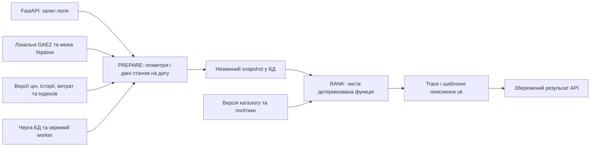

# Межі реалізованого MVP та рішення A0

Уточнення користувача від 2026-10-21: уся Україна; лише API; локальний запуск;
агронома й урожайності немає; ціни надходитимуть як CSV «культура–ціна», історія
як API «культура–рік»; витрати й API готових супутникових індексів реалізуються
в цьому сервісі; публічні дані можна завантажувати в межах 10 ГБ.

Основний профіль — `gaez_baseline`. Він порівнює просторовий потенціал GAEZ,
повертає `LIMITED` та до п'яти умовних кандидатів. Невідомі місцеві календарі,
сівозміна, погода й економіка не додають вигаданих штрафів або бонусів. Множники
1 у відповіді означають вимкнений компонент; trace та assumptions це фіксують.
Середній клімат GAEZ не є прогнозом конкретного врожаю.

Цей профіль навмисно відрізняється від повного агрономічного плану SPEC:

- Він не вимагає схвалених регіональних вікон для показу потенціалу.
- Статус `conditional` отримують усі кандидати; обмеження двома умовними
  культурами з повного рушія тут не застосовується.
- Немає непідтвердженого мінімального агропорога. Нульовий потенціал і
  недостатнє покриття не перетворюються на рекомендацію.
- Три просторові сортування за межами інтервалу не підміняють повну сітку
  стійкості: мітка лишається `unavailable`.
- Ціни й витрати довідкові. Без урожайності виручка й маржа `null`.

Повний профіль `validated` реалізований окремо: бар'єри G1–G5, інтервали,
консервативні яруси, економічні рівності, детермінована сітка, режими пропусків.
Незатверджені параметри вимкнені. Суперечності початкового дизайну та обмеження
гарантії «пропуск не покращує» описані в `ranking-decisions.md`. Синтетичний
пакет для перевірки всіх компонентів не має вигаданих людських схвалень.

Агенти A1–A8 працювали окремими хвилями на спільних контрактах A0. A0 інтегрував
конфігурацію, доменні моделі, схему БД, snapshot, конвеєр, базовий профіль та
локальний запуск. Висновки A8 і перелік зовнішніх перевірок наведено в
`quality-report.md`; пакет для майбутнього агронома — `agronomy-review.md`.

Наступні розширення залежать від конкретних джерел: автоматичне отримання
історії з майбутнього API, реальні ціни, погодні випуски, погоджені нормативи
витрат. API індексів зараз приймає готові статистики. Самостійне завантаження
Sentinel-2 й обчислення NDVI/NDMI з каналів потребує окремого узгодження обсягу.
Ці залежності не приховані за синтетичними production-даними.
